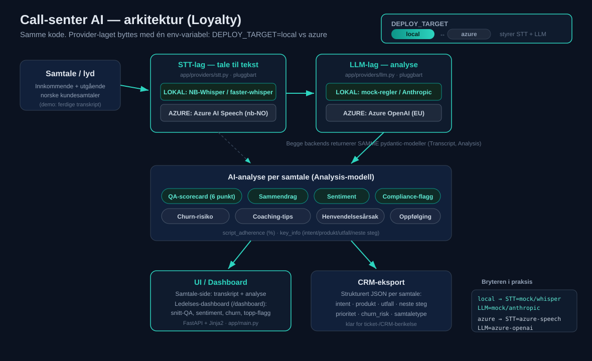

# Arkitektur — Call-senter AI-demo (Loyalty)

Dette dokumentet beskriver hvordan demoen er bygget, hvorfor provider-laget er
pluggbart, hvordan samme kode kjører lokalt eller på Azure, og hvordan dette
treffer Loyaltys behov (STT-valg for norsk, personvern, skala).



## Dataflyt i ett blikk

```
Samtale / lyd
   → STT-lag (tale → tekst)        app/providers/stt.py
   → LLM-lag (analyse)             app/providers/llm.py
   → Analyse-resultat (Analysis)   app/models.py
   → UI / Dashboard + CRM-eksport  app/main.py + app/routers/dashboard.py
```

Hvert steg er et eget lag med en fast kontrakt. STT-laget produserer en
`Transcript`, LLM-laget konsumerer den og produserer en `Analysis`. UI-et leser
kun disse to modellene og bryr seg ikke om hvilken backend som lå bak.

## Det pluggbare provider-laget

To lag er pluggbare, og begge har flere utbyttbare backends. Backend velges av
env-variabler — ikke av kodeendringer.

### STT-laget (`app/providers/stt.py`)

`transcribe(audio_or_name) -> Transcript`. Backend styres av `STT_BACKEND`:

| Backend | Hva | Kjøring |
|---|---|---|
| `mock` | Ferdige norske demo-transkript fra `data/*.json` | Offline, ingen nøkler |
| `faster-whisper` | Lokal Whisper (CTranslate2) | Lokal GPU/CPU, import-guardet |
| `nb-whisper` | Nasjonalbibliotekets norsk-tunede Whisper (`NbAiLab/nb-whisper-*`) | Lokal, import-guardet |
| `azure` | Azure AI Speech (`nb-NO`) | Sky, krever nøkkel + region |

### LLM-laget (`app/providers/llm.py`)

`analyze(transcript) -> Analysis`. Backend styres av `LLM_BACKEND`:

| Backend | Hva | Kjøring |
|---|---|---|
| `mock` | Deterministisk regelbasert analyse | Offline, alltid samme svar |
| `anthropic` | Anthropic SDK (`claude-opus-4-8`) | Sky-uavhengig, krever API-nøkkel |
| `azure-openai` | Azure OpenAI (EU / Sweden Central) | Sky, krever endpoint + nøkkel |

Begge lag returnerer **samme pydantic-modeller** (`Transcript`, `Analysis` i
`app/models.py`). Det er denne stabile kontrakten som gjør backends utbyttbare:
UI, dashboard og CRM-eksport er kodet mot modellene, ikke mot en bestemt
leverandør. En ekte LLM som svarer med løs JSON blir normalisert inn i `Analysis`
av `_coerce_analysis()`, slik at manglende eller uventede felt aldri knekker UI-et.

## Lokal ↔ Azure-portabiliteten — én bryter

`app/config.py` har én sentral bryter: `DEPLOY_TARGET` (`local` | `azure`).
Den setter smarte defaults for begge provider-lagene:

| `DEPLOY_TARGET` | STT-default | LLM-default | Resultat |
|---|---|---|---|
| `local` (default) | `mock` | `mock` | Kjører helt offline, ingen nøkler/nett |
| `azure` | `azure` | `azure-openai` | Hele systemet peker på Azure-tjenester |

Du kan fortsatt overstyre enkeltlag manuelt med `STT_BACKEND` / `LLM_BACKEND`
(f.eks. lokal NB-Whisper for STT + Azure OpenAI for analyse). Men det normale er:
**bytt `DEPLOY_TARGET` (én linje) → hele systemet flytter seg**, uten kodeendring.

Azure-integrasjonspunktene er allerede wiret i koden (søk etter
`AZURE-INTEGRASJONSPUNKT` i `stt.py` og `llm.py`). De kjøres ikke uten nøkler;
med nøkler satt aktiveres de kommenterte kall-blokkene. Samme container-image
kjører dermed begge steder — kun env-variabler skiller dem.

## Robusthet — demoen knekker aldri

- Mock-backendene krever verken nett eller nøkler, så demoen er alltid grønn.
- De tunge lokale backendene (`faster-whisper`, `nb-whisper`) er import-guardet:
  mangler pakken, faller laget tilbake til mock med en advarsel.
- Feature-rutere (dashboard m.fl.) auto-inkluderes i `app/main.py`, men en modul
  som feiler tar ikke ned kjernen.
- LLM-output normaliseres til `Analysis` uansett hvor «løs» JSON-en er.

## Hvordan dette matcher Loyaltys behov

**STT-valg for norsk.** Loyalty skal velge STT for norske samtaler. Demoen gjør
valget til en konfigurasjon, ikke en arkitektur-låsing: test NB-Whisper (norsk-
tunet, kjører lokalt) opp mot Azure AI Speech (`nb-NO`, driftet) bak *samme*
kontrakt, og bytt uten å røre resten av systemet. Beslutningen kan tas på data,
ikke på leverandør-innlåsing.

**Personvern / datalokasjon.** Sensitive ledd kan holdes lokalt mens man bruker
sky der det er trygt. Eksempel: kjør STT lokalt (lyd forlater aldri huset) men
LLM-analyse på Azure OpenAI i EU-region (Sweden Central). PII-maskering hører
hjemme i STT-laget rett etter transkripsjon — *før* tekst lagres, vises eller
sendes til LLM (se README «Produksjon»). EU-region + DPA dekker datalokasjon for
de driftede tjenestene.

**Skala.** Web-appen er stateless (FastAPI), så den skalerer horisontalt på
Azure Container Apps / App Service. STT og LLM er separate lag og kan skaleres
uavhengig: tunge transkripsjonsjobber treffer ikke analyse-laget. Med 400+
ansatte og store samtalevolum betyr det at man kan dimensjonere de to flaskehalsene
hver for seg, og flytte arbeidslast lokalt ↔ sky etter kost og personvern.

## Arbeidslast → hvor → hvorfor

| Arbeidslast | Hvor (lokal / Azure) | Hvorfor |
|---|---|---|
| Transkripsjon av norsk tale (STT) | **Begge** — NB-Whisper lokalt eller Azure AI Speech | Lokalt = lyd/PII forlater aldri huset + ingen per-minutt-kost; Azure = driftet, skalerer, `nb-NO` med taler-separasjon |
| PII-maskering (personnr., kontonr.) | **Lokal**, i STT-laget rett etter transkripsjon | Sensitive felt fjernes før data lagres/vises/sendes videre |
| LLM-analyse (QA, sentiment, sammendrag, churn) | **Begge** — mock/Anthropic lokalt eller Azure OpenAI | Azure OpenAI i EU-region holder data i EU under DPA; lokal mock for offline-demo/test |
| Aggregering / dashboard (voice-of-customer) | **Hvor som helst** — stateless FastAPI | Ingen sensitiv lyd, kun avledede tall; skalerer horisontalt |
| CRM-eksport (strukturert JSON) | **Hvor som helst** | Lett strukturert payload; berikelse av ticket/CRM-system |
| Batch-QA på store volum | **Azure** (Container Apps, autoskalering) | Elastisk kapasitet ved topp-volum; STT og LLM skaleres uavhengig |
| Demo / PoC / evaluering | **Lokal** (`DEPLOY_TARGET=local`) | Null nøkler, null kost, deterministisk — kjør hvor som helst på sekunder |

## Sentrale filer

| Fil | Ansvar |
|---|---|
| `app/config.py` | `DEPLOY_TARGET` → backend-valg (portabilitets-bryteren) |
| `app/providers/stt.py` | `transcribe()` — mock / whisper / nb-whisper / azure |
| `app/providers/llm.py` | `analyze()` — mock / anthropic / azure-openai |
| `app/models.py` | `Transcript`, `Analysis`, `Scorecard`, `KeyInfo` (kontrakten) |
| `app/main.py` | FastAPI-web-UI + provider-banner |
| `app/routers/dashboard.py` | Aggregert ledelses-dashboard (`/dashboard`) |
